# Bitcade

**Free browser games you can play right on X.** Bitcade is my home for quick, one-tap games and tools for the Aptos community, plus the story of how each one launched and grew. I'm Angel ([@angelataptos](https://x.com/angelataptos)), a community and product builder in the Aptos ecosystem.

**[Visit bitcade.xyz →](https://bitcade.xyz)** · [Work](https://bitcade.xyz/work) · [About](https://bitcade.xyz/about) · free, no sign-up, made for phones as much as desktop

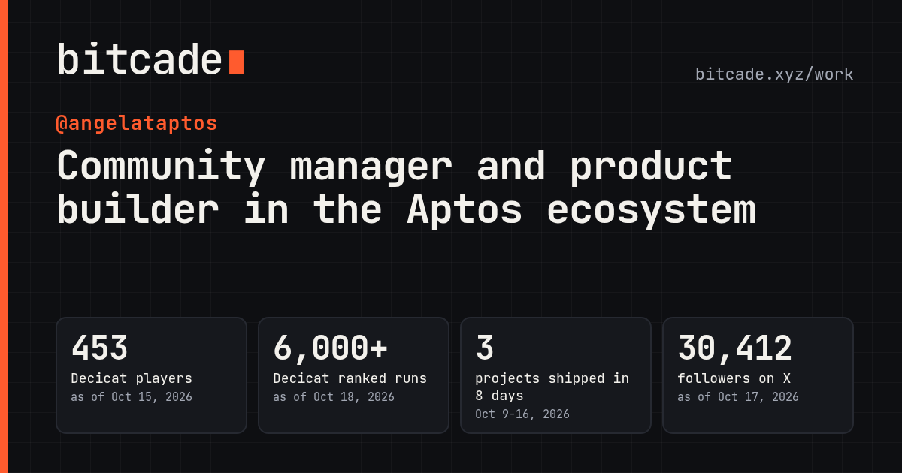

## Why I made it

Games are the fastest way I know to bring a community together. A post on X, a tap, and you're playing: no installs, no accounts. Bitcade is one home for those games, and for the projects around them, so anyone can play, see how each launch went, and follow what comes next.

## What's on it

- **Games hub** (`/`): a short intro, the live games with short gameplay clips, a live top-5 ticker for Decicat, and Tracktos under Tools
- **Work** (`/work`): headline numbers, a launch timeline from Oct 9 to Oct 16, 2026, one card per project with its role, launch date, results and links, the X posts behind each launch, and players sharing their own runs
- **Play here**: open Decicat or Stacktos in a window right on the work page, or in a new tab
- **One-pager**: a tidy one-page PDF of the work page, ready to download
- **About** (`/about`): who I am, what I've built and how to get in touch
- **Every number shows its date**, and the Decicat figures stay current from the game's public leaderboard

## The projects

| Project | What it is | Launched |
| --- | --- | --- |
| [Decicat: A Decibel Adventure](https://decicat.bitcade.xyz) | One-touch pixel-art runner for the Decibel community, playable right inside X. Original concept by [@doncastro](https://x.com/doncastro) | Oct 9, 2026 |
| [Stacktos: Aptor's Ascent](https://stacktos.bitcade.xyz) | One-tap tower climber where every block is a real, recent Aptos transaction | Oct 16, 2026 |
| [Tracktos](https://tracktos.com) | A friendly window into Aptos wallets and the network | Relaunched Oct 14, 2026 |
| ACID | Aptos Community Intelligence Dashboard for community teams (private, sign-in restricted) | |

Showcases: [decicat-showcase](https://github.com/angel-andre/decicat-showcase) · [stacktos-showcase](https://github.com/angel-andre/stacktos-showcase) · [tracktos-showcase](https://github.com/angel-andre/tracktos-showcase) · [acid-showcase](https://github.com/angel-andre/acid-showcase)

## The numbers

*The same figures shown on bitcade.xyz, each with its date.*

| | |
| --- | --- |
| Decicat players | **453** (as of Oct 15, 2026) |
| Decicat ranked runs | **6,097** (as of Oct 18, 2026) |
| Decicat launch post on X | **222,145** impressions (as of Oct 17, 2026) |
| Tracktos relaunch post on X | **100,005** impressions (as of Oct 17, 2026) |
| Runs in Decicat's first 2 hours | **about 314** (Oct 9, 2026) |
| Projects shipped | **3 in 8 days** (Decicat, Tracktos relaunch, Stacktos; Oct 9-16, 2026) |
| Followers on X, [@angelataptos](https://x.com/angelataptos) | **30,412** (as of Oct 17, 2026) |

## Screenshots

| Home | Work | About |
| --- | --- | --- |
| 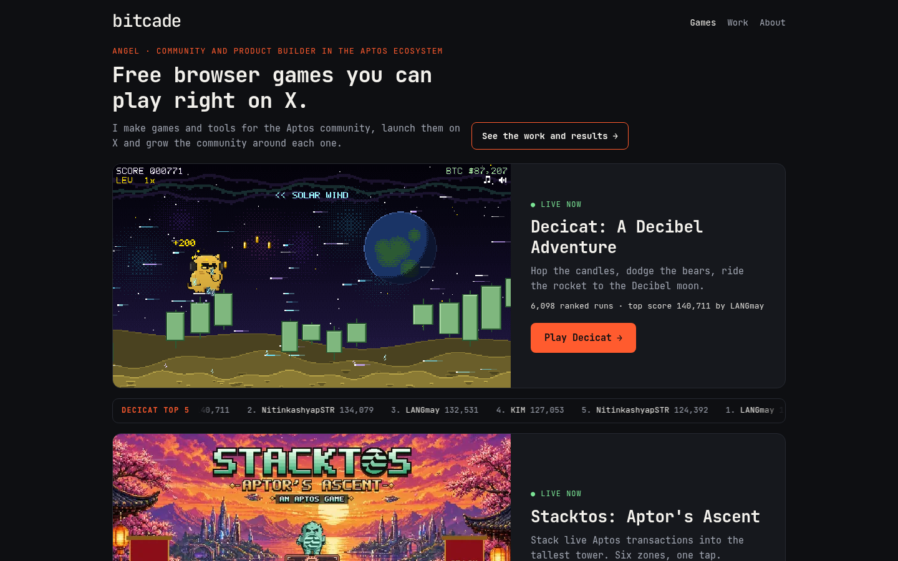 | 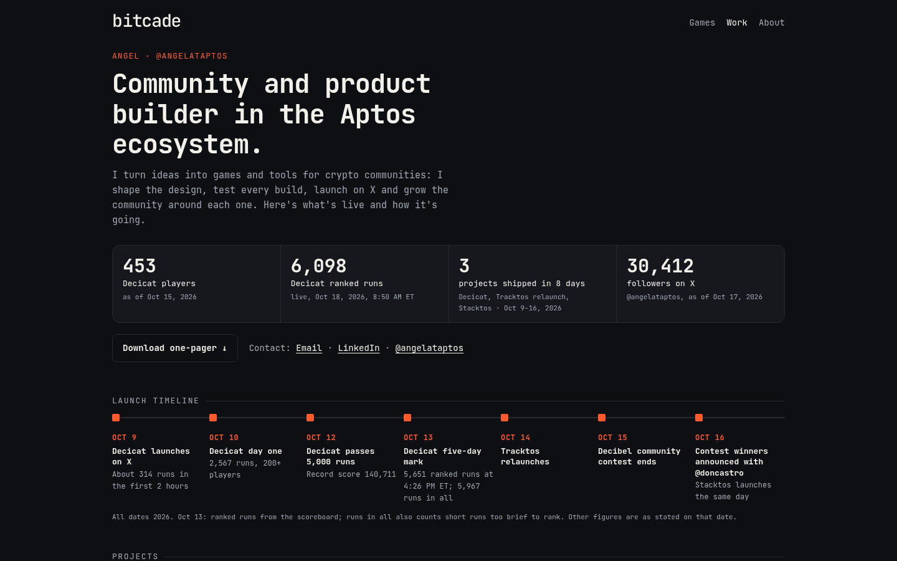 | 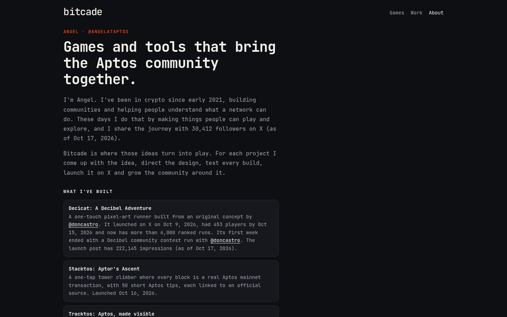 |

| Home on a phone | Work on a phone | About on a phone | Stacktos in the Play here window |
| --- | --- | --- | --- |
| 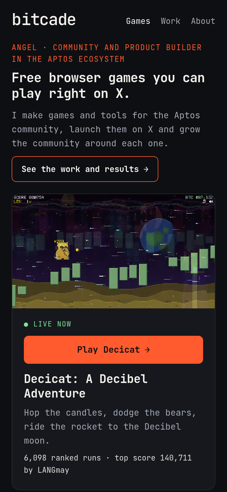 | 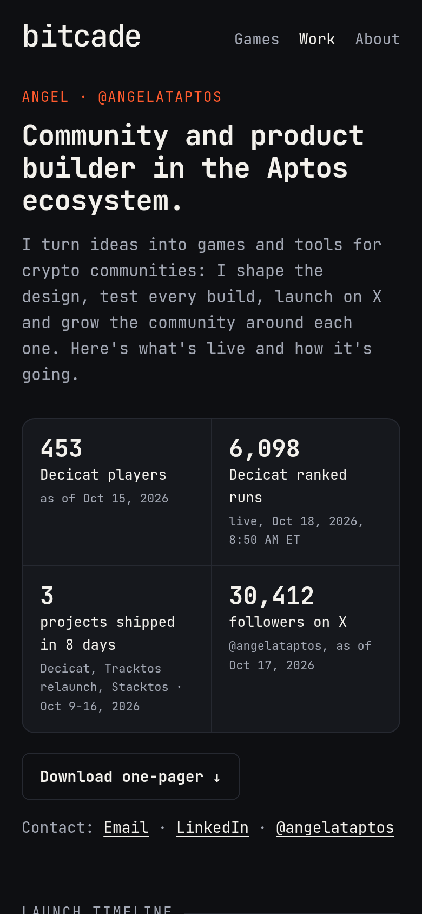 | 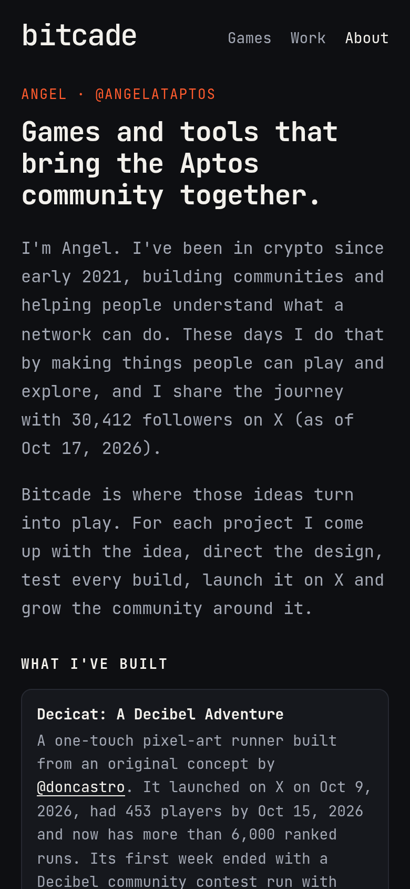 | 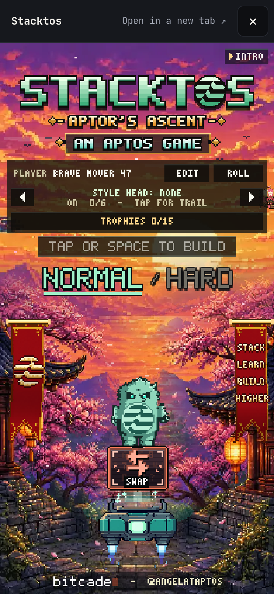 |

### Play here

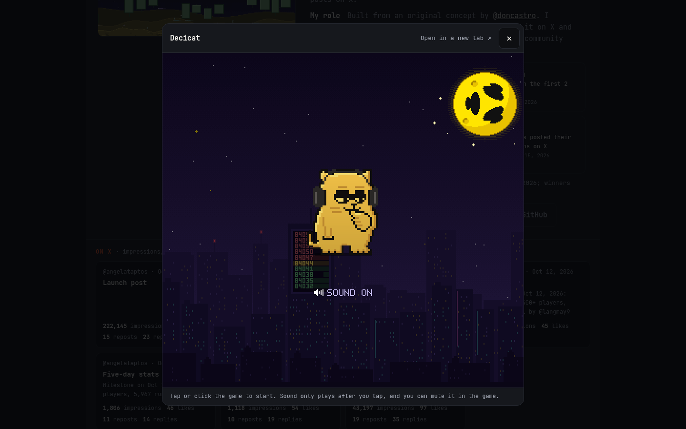

### The one-pager

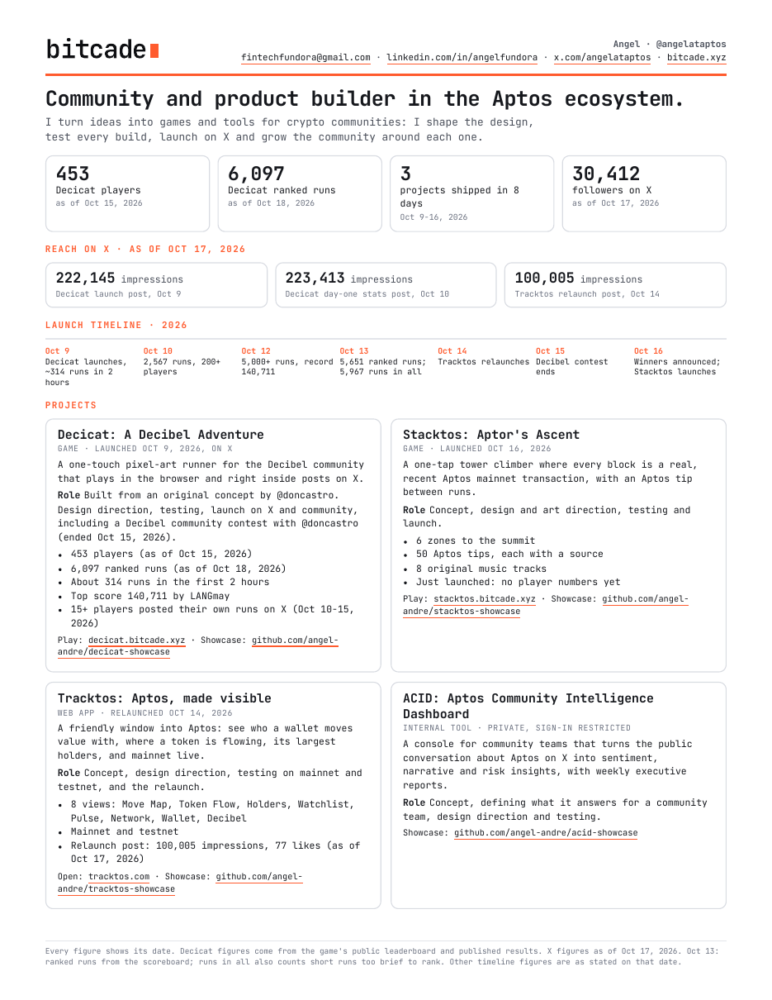

## How it fits together

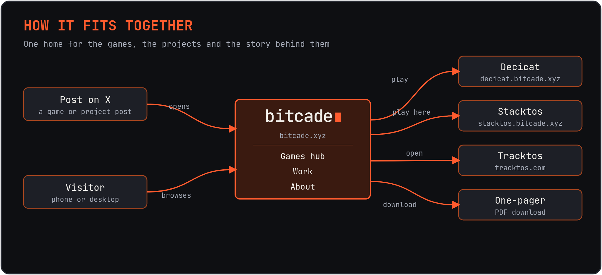

## What I focused on

- **One tap to play.** Every game opens straight from a post on X or the hub, on any screen.
- **Honest numbers.** Only figures I can verify, always with their date.
- **Fast and calm on phones.** Light pages, clips that only play when you look at them, and motion that respects reduced-motion settings.
- **One consistent look.** Lowercase monospace logo, an orange blinking block, and the same dark arcade style across the hub, work and about pages, the share cards and the one-pager.

## Credits

Bitcade by [@angelataptos](https://x.com/angelataptos)  
Original Decicat concept by [@doncastro](https://x.com/doncastro)  
JetBrains Mono typeface, SIL Open Font License

## License

Copyright (c) 2026 Angel Fundora. All rights reserved. Source code is private.
See [LICENSE](LICENSE).
